# Fourth down: go, punt, or kick?

On each 4th down, which choice gives the offense the higher chance of winning the game: going for it, punting, or kicking a field goal? NFL coaches follow that recommendation a little more than half the time. When the model says to go and the call is clear, they go less than half the time, and that is where almost all of the win probability gets left on the table. They have become more aggressive. In 2018 they went for it on 31% of clear "go" calls. In 2025 they went on 54%. A model-free check, 4th-and-1 between the 40s, moved from 40% to 70% over the same years.

The grades below use play-by-play from the 2014 through 2025 seasons. Every coach decision in 2018–2025 is scored by a model that did not train on that season. The numbers are from `results/summary.json` after `python3 scripts/run_pipeline.py`.

## The short version

| | |
| --- | --- |
| Plays in the file | 580,005 (regular season and playoffs, 2014–2025) |
| Fourth downs graded | 31,236 in 2018–2025, of which 24,749 pass the leaderboard filter |
| Coaches followed the recommendation | 56.7% of leaderboard plays; 63.8% when the best option led by at least 2 percentage points |
| Win probability left on the table | 0.84 percentage points per play; 1.35 on those clear calls |
| When the model says go, and the edge is at least 2 points | Coaches went for it 39.7% of the time (6,057 plays) |
| Held-out win-probability log loss | 0.452 for this model, 0.444 for nflfastR `vegas_wp`, 0.481 for nflfastR `wp` |
| Held-out Brier score | 0.150 here, 0.147 for `vegas_wp`, 0.162 for `wp` |

`vegas_wp` is the fair comparison. Both models know the pregame point spread. nflfastR's plain `wp` does not, so beating it is a weaker claim. This model beats plain `wp` in every held-out season and beats `vegas_wp` in 2022 only. The average gap versus `vegas_wp` is about 0.008 log loss.

## How to run

Python 3.11 or newer. From the repo root:

```bash
python3 -m venv .venv
source .venv/bin/activate
pip install -r requirements.txt
python3 scripts/pull_data.py          # writes data/raw/pbp_slim.parquet; skips the download if it is already there
python3 scripts/run_pipeline.py       # writes results/, figures/, and models/current.joblib
pytest
streamlit run app/streamlit_app.py --server.port 8741 --server.address 0.0.0.0
```

The notebook reads the saved results and the saved model. It does not refit anything:

```bash
python3 -m jupyter nbconvert --to notebook --execute notebooks/fourth_down_story.ipynb --inplace
```

`python3 scripts/run_pipeline.py --quick` is a debug fit on fewer seasons and 40 trees. Do not quote it.

The play-by-play cache is regenerated by `python scripts/pull_data.py` / the pipeline. That script downloads nflverse and writes `data/raw/pbp_slim.parquet` (about 27 MB, 56 columns). Pass `--refresh` to replace a file that is already there. `python3 scripts/run_pipeline.py` rebuilds the grades, figures, and model bundle from that cache. The pull stops at 2025. As of October 2026 the 2026 season was in week 7, so it is not a full season and it is not in the file.

## Data

Source: nflverse play-by-play through `nflreadpy`, seasons 2014–2025, regular season and playoffs. The cache script keeps the columns listed in `fourth_down.config.SLIM_COLUMNS` and writes `data/raw/pbp_slim.parquet`.

nflfastR's `wp`, `vegas_wp`, expected points, and field-goal probability are stored for the comparison only. None of them is a feature.

Pregame strength is nflverse `spread_line`, the closing expected home margin. Positive means the home team is favored. That sign was checked on 2024: the correlation between `spread_line` and the final home margin is positive. The model uses `expected_margin`, which flips the sign when the away team has the ball, so a positive number always means "the offense is favored."

DuckDB runs the coach, team, and trend aggregations in `sql/`. The modeling code decides what each play was worth. SQL then computes rates, means, and a standard error.

## Method

Four pieces, all fit in this repo:

1. **Win probability.** An XGBoost classifier (depth 5, up to 400 trees, learning rate 0.05, monotone constraints) predicts the probability that the team with the ball wins, from score differential, time left, field position, down and distance, timeouts, home field, the pregame spread, and whether that team receives the second-half kickoff. Two constructed features carry interactions the tree would otherwise have to discover: `score_time` (the lead, scaled by time left) and `field_time` (field position, scaled the same way). Ties are dropped from training. Overtime is excluded. Probabilities are Platt-scaled on the previous season: a one-coefficient logistic regression on the logit of the raw probability.

2. **Fourth-down conversion.** Two binomial GLMs, fit only on 4th-down passes and runs, give P(success) and P(touchdown) from yards to go, field position, goal-to-go, and a year term. Failures are split into turnover on downs, a giveaway, a defensive touchdown, and a safety, using the historical mix. A conversion that was not ruled a touchdown still becomes one if the sampled yards cross the goal line.

3. **Field goals.** Make probability is an isotonic curve in kick distance (the line of scrimmage plus 17 yards). A binomial GLM then adds indoor, wind, cold (outdoor and 40°F or below), altitude (Denver), and year, with the distance curve as an offset. Kicks longer than 68 yards are treated as unavailable. A miss is spotted with the usual rule: the opponent takes over 8 yards behind the line of scrimmage, or at the 20 if that spot is inside the offense's 20.

4. **Punts.** For each yard line, the model keeps a quantile distribution of what actually happened next: opponent field position, a return score, or a rare keep (block). Touchbacks pile up, so a normal residual would be the wrong shape.

The decision is the probability-weighted win probability of the next state. If the play would run the half out, the next state is the second-half kickoff and timeouts reset. If it would run the game out, win probability is 1, 0, or 0.5 from the final score. Otherwise the clock just moves. Elapsed time is measured to the next snap, about 7 seconds for a scrimmage play or a score and 9 seconds for a punt, because the game clock does not run through the kickoff.

League-average conversion and kicking rates are used on purpose. A strong offense should go a little more often than the chart, and a shaky kicker should kick a little less. There is no team-level shrinkage.

**Validation.** For a test season T, the win-probability trees train on seasons through T−2. Season T−1 is used for early stopping and Platt scaling. Season T is never seen. Field goals, conversions, and punts for that grade are fit on all seasons before T. Folds start in 2018 so every fold has a calibration season. The chart and the Streamlit app use a separate bundle: trees on 2014–2024, Platt and early stopping on 2025, component models on every season. Coach grades do not use that bundle.

The leaderboard drops 4th-and-more-than-20, the last 30 seconds of a half, and plays where the pre-snap win probability is under 2% or over 98%. A call is "clear" when the best option leads by at least 2 percentage points of win probability.

## Win probability, held out by season

303,518 scrimmage plays in 2018–2025 had both an nflfastR `wp` and a `vegas_wp`. Log loss is the average of `-[y log p + (1-y) log(1-p)]`. Lower is better. Calibration MAE is the average absolute gap between predicted probability and observed win rate across ten equal-count bins.

| Season | Plays | Log loss, this model | Log loss, before Platt | nflfastR wp | vegas_wp | Calibration MAE | Corr. with wp |
| --- | ---: | ---: | ---: | ---: | ---: | ---: | ---: |
| 2018 | 36,341 | 0.444 | 0.441 | 0.460 | 0.422 | 0.024 | 0.904 |
| 2019 | 36,835 | 0.434 | 0.434 | 0.456 | 0.419 | 0.014 | 0.916 |
| 2020 | 37,328 | 0.425 | 0.425 | 0.477 | 0.418 | 0.006 | 0.915 |
| 2021 | 38,841 | 0.440 | 0.439 | 0.461 | 0.430 | 0.027 | 0.907 |
| 2022 | 38,582 | 0.510 | 0.512 | 0.556 | 0.516 | 0.026 | 0.920 |
| 2023 | 39,249 | 0.461 | 0.457 | 0.473 | 0.452 | 0.034 | 0.942 |
| 2024 | 38,507 | 0.420 | 0.419 | 0.462 | 0.415 | 0.026 | 0.924 |
| 2025 | 37,835 | 0.479 | 0.472 | 0.504 | 0.475 | 0.041 | 0.909 |
| Play-weighted | 303,518 | 0.452 | 0.450 | 0.481 | 0.444 | 0.025 | 0.917 |

Correlation with `vegas_wp`, play-weighted, is 0.988. Brier score is 0.150 here, 0.147 for `vegas_wp`, and 0.162 for plain `wp`.

2022 is a high-log-loss year for every model in the table (0.510, 0.516, and 0.556). It is also the only season in which this model beats `vegas_wp`.

Platt scaling, fit on the previous season, did not help the headline. Play-weighted log loss is 0.450 before scaling and 0.452 after it. The app bundle's slope on 2025 is 0.89, and that season's own log loss moved from 0.472 to 0.470. That 2025 figure is the early-stopping season for the app bundle, so it is a little optimistic. The table above is the one to cite. The calibration plot is still close to the diagonal.

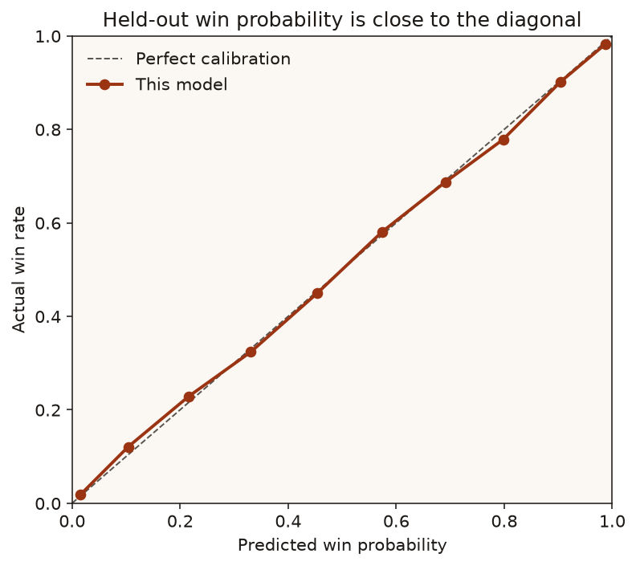

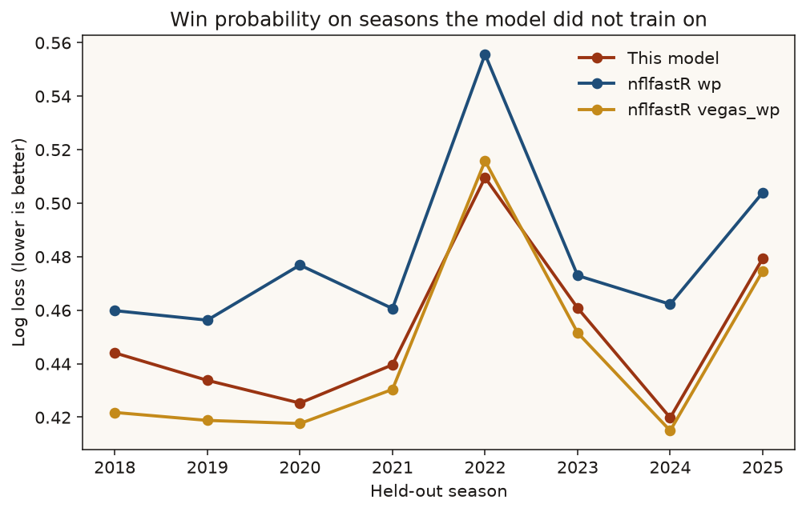

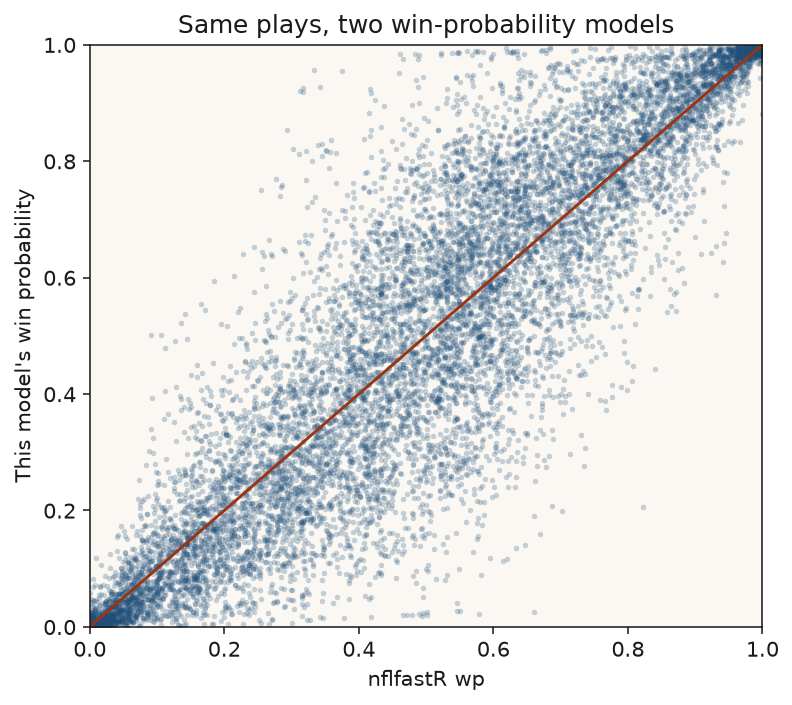

Feature importance on the app bundle is dominated by the score: `score_diff` 0.47, `score_time` 0.28, `expected_margin` 0.15. `field_time` is 0.023 and raw `yardline_100` is 0.010. Field position is real, and it matters more late, which is why it is in the model as an interaction with the clock. `receive_2h_if_relevant` received no splits.

## The decision

Same neutral game (home team, pick 'em, three timeouts each), three clocks.

Opening kickoff, 679 of 990 yard-line-by-distance cells say go and 311 say punt. None say field goal. A made field goal early hands the opponent the ball up only 3, and this win-probability model prices that state at about 51.5% for the kicking team. Going for it from the opponent's 25 is about 53% to 57%, depending on distance. The gap is a few points, so the chart paints the opponent's half green. See the limitations: vegas prices that same kickoff a few points higher for the team that just scored.

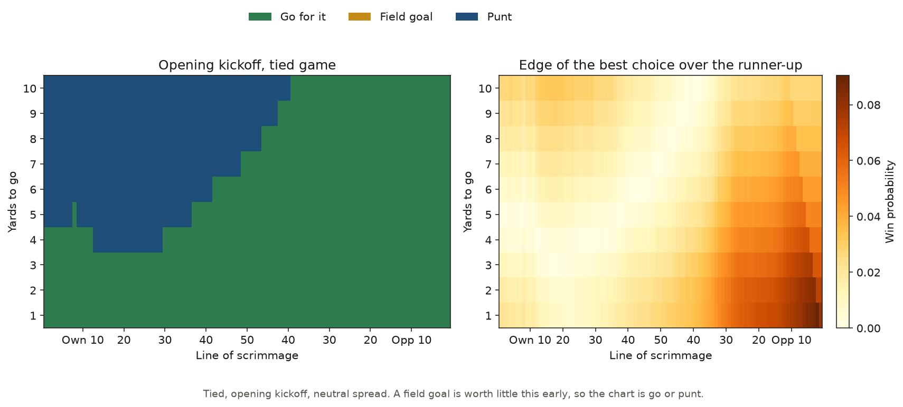

With 5:00 left in a tied game the field-goal band appears for the longer kicks, 269 of 990 cells. Short yardage still says go.

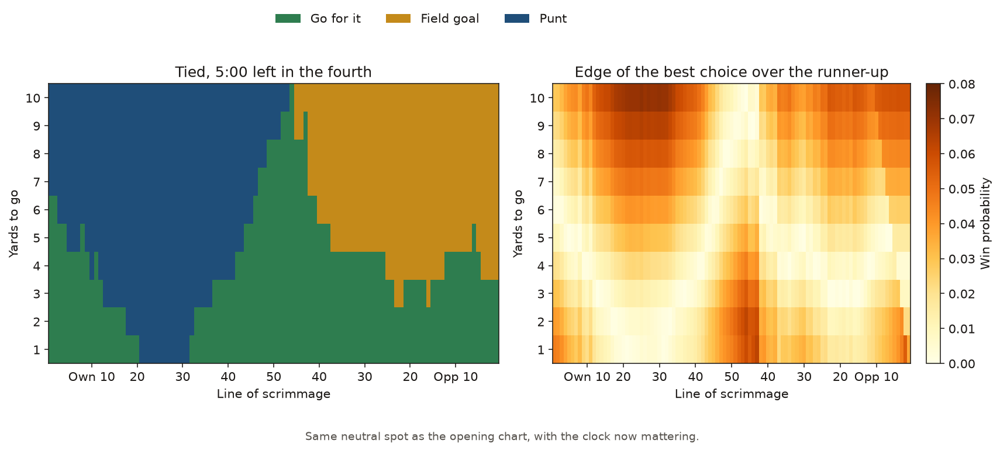

Down 3 with 2:00 left, punting disappears (0 of 990 cells). A field goal ties the game; going for it can take the lead. The chart is 723 go and 267 field goal.

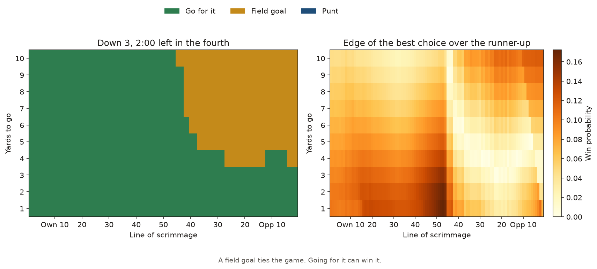

A few single spots from the app bundle, tied, opening kickoff, home, neutral spread:

| Situation | Go | Punt | Field goal | Call |
| --- | ---: | ---: | ---: | --- |
| 4th-and-10, own 10 | 0.432 | 0.458 | — | Punt, by 2.7 points |
| 4th-and-12, own 35 | 0.462 | 0.494 | — | Punt, by 3.2 points |
| 4th-and-1, own 40 | 0.517 | 0.497 | — | Go, by 2.0 points |
| 4th-and-6, opponent 28 | 0.544 | 0.506 | 0.505 | Go, by 3.8 points |
| 4th-and-1, opponent 2 | 0.606 | 0.488 | 0.515 | Go, by 9.0 points |

Own-40, 4th-and-1 is a close call. The conversion model says about 69.6% from that spot (4th-and-1, `yardline_100` 60, 2025). A punt from the own 35–45 has historically left the opponent near their own 18. Two points of win probability is the cutoff used for a "clear" call, and this spot sits right on it. 4th-and-1 from the own 1 is also a go in the app bundle, 0.470 against a punt at 0.447. The edge is 2.2 points. A punt from the goal line is a bad play, and a 4th-and-1 converts often enough that the model leans go. It is not a loud recommendation.

Field-goal make rates from the distance curve (12,629 kicks, 84.7% made): 96.3% from 30, 87.7% from 40, 76.4% from 45, 72.1% from 50, 61.3% from 55, 43.8% from 60.

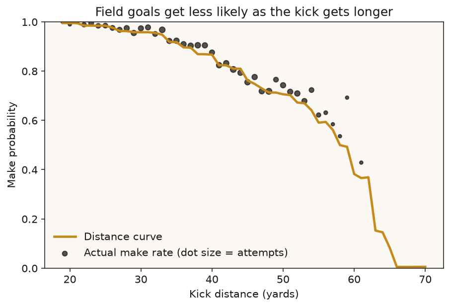

Fourth-down conversion at midfield in the 2025 component model: 68.6% on 4th-and-1, 63.5% on 4th-and-2, 58.4% on 4th-and-3, 48.4% on 4th-and-5, 29.1% on 4th-and-10. The fit uses 7,944 fourth-down passes and runs, which succeeded 52.7% of the time and scored a touchdown 9.0% of the time. Among failures, 90.5% were turnovers on downs, 8.2% were giveaways, 0.9% were defensive touchdowns, and 0.4% were safeties. After an offensive touchdown the point mix is 9.1% for 6, 86.7% for 7, and 4.2% for 8.

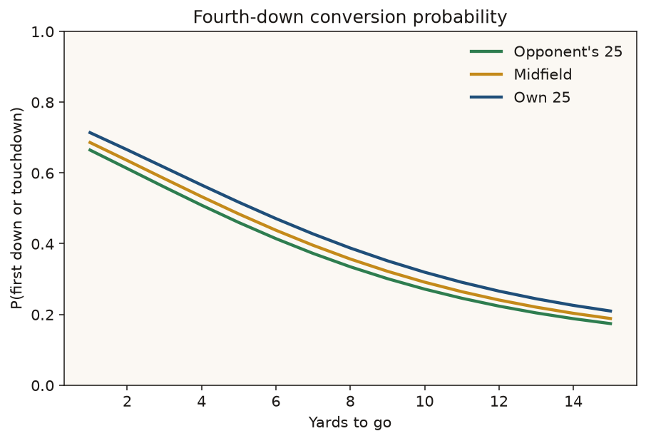

The weather GLM, on top of the distance curve, is mostly a null result. Wind is −0.0049 log-odds per mph (p = 0.42). A dome is about zero (p = 0.99). Denver is −0.08 (p = 0.56), which is the wrong direction for altitude and too noisy to use as a story. Cold (outdoor, 40°F or below) is +0.29 log-odds (p = 0.001). That sign is the opposite of the usual "cold hurts kickers" story. The likely reason is selection: the kicks that are attempted in the cold are not a random sample of distances, and the distance offset does not capture everything the coach saw. On 400 cold field-goal situations scored with the app bundle, setting the cold flag to zero flipped the recommendation 3.5% of the time and moved field-goal win probability by about 0.2 percentage points. The coefficient is reported because it was estimated. It should not be described as evidence that cold helps.

Punts in the component model: 27,056, with a median of 9 seconds from the snap to the next scrimmage play.

## What coaches did

On the 24,749 leaderboard plays:

| Model's recommendation | Plays | Coach took it | Win probability left per play |
| --- | ---: | ---: | ---: |
| Punt | 7,071 | 97.3% | 0.03 percentage points |
| Field goal | 4,256 | 82.6% | 0.30 percentage points |
| Go for it | 13,422 | 27.1% | 1.44 percentage points |

Coaches punt when the model says punt. They mostly kick when it says kick. They go for it on about a quarter of the plays where going is best, and that is the gap. Among the 6,057 plays where going led by at least 2 percentage points, they went 39.7% of the time. 16.2% of leaderboard plays (4,003) left at least 2 percentage points on the table. 2.8% left at least 5.

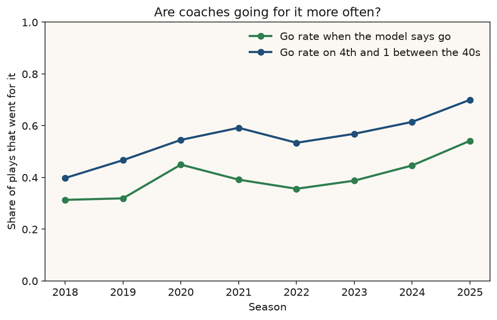

| Season | Leaderboard plays | Go rate, all | Go rate when the model says go (clear) | Go rate, 4th-and-1 between the 40s | WP left per play |
| --- | ---: | ---: | ---: | ---: | ---: |
| 2018 | 2,793 | 11.4% | 31.3% (632 plays) | 39.8% (176) | 0.92 pp |
| 2019 | 2,955 | 14.2% | 31.9% (752) | 46.7% (165) | 0.98 pp |
| 2020 | 2,859 | 16.5% | 45.0% (516) | 54.5% (189) | 0.62 pp |
| 2021 | 3,061 | 17.3% | 39.1% (833) | 59.2% (196) | 0.94 pp |
| 2022 | 3,339 | 17.1% | 35.6% (1,008) | 53.4% (221) | 1.03 pp |
| 2023 | 3,572 | 18.1% | 38.7% (831) | 56.9% (204) | 0.82 pp |
| 2024 | 3,187 | 18.0% | 44.6% (800) | 61.5% (205) | 0.77 pp |
| 2025 | 2,983 | 19.7% | 54.2% (685) | 70.0% (200) | 0.63 pp |

The 4th-and-1 series does not depend on the win-probability model. It is every 4th-and-1 with the ball between the offense's 40 and the opponent's 40, inside the same leaderboard filter. Both series rise. Win probability left per play is lower in 2025 (0.63 pp) than in 2018 (0.92 pp). 2022 is the high year at 1.03 pp, the same season the win-probability model itself is least sharp.

### Teams, 2018–2025 pooled

At least 200 decisions. The standard error is the usual one for a mean. Plays in the same game are correlated, so the interval is a little tight. Treat the order as a sample-size warning.

Least left on the table: Green Bay 0.67 pp (SE 0.05, n = 702), Chicago 0.70 (0.05, 805), Arizona 0.70 (0.05, 740), Philadelphia 0.72 (0.05, 818), Cleveland 0.73 (0.05, 807).

Most: New England 1.09 pp (SE 0.06, n = 743), Pittsburgh 1.06 (0.06, 867), San Francisco 0.99 (0.06, 692), the Chargers 0.99 (0.06, 789), Denver 0.99 (0.06, 853).

The gap from Green Bay to New England is about 0.42 percentage points, larger than either standard error. It is still a small number per play.

### Head coaches, at least 250 decisions

Least: Raheem Morris 0.60 pp (SE 0.08, n = 260, 3 seasons, Atlanta). That sample is the shortest on the "least" list. Dan Campbell 0.64 (SE 0.05, n = 470, Detroit), and he went for it on 62% of clear "go" calls. Nick Sirianni 0.65 (0.05, 506, Philadelphia).

Most: Bill Belichick 1.20 pp (SE 0.08, n = 556, New England, 2018–2023). He went for it on 22.8% of clear "go" calls. In those same seasons the league rate was 36.7% (4,572 such plays). Mike Tomlin 1.06 pp (SE 0.06, n = 867, all eight seasons, Pittsburgh), with a go-when-the-model-says-go rate of 26.4%. Matt Patricia 1.10 (SE 0.11, n = 252, three seasons).

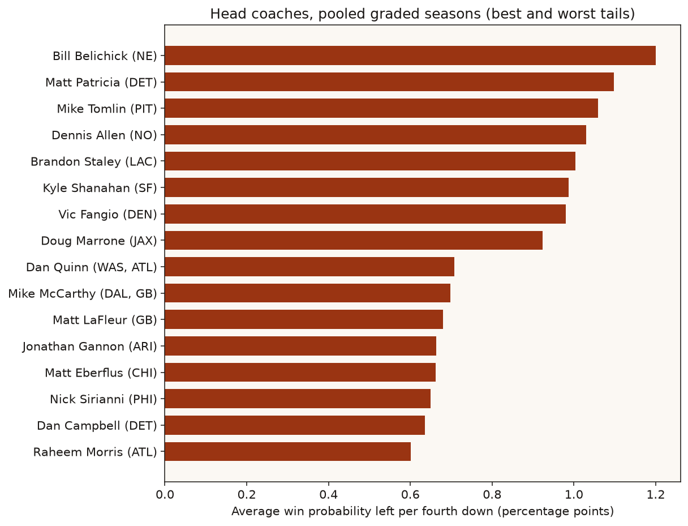

### 2025 only

One season is about 80 to 120 decisions. Detroit left 0.38 pp per play (SE 0.08, n = 88) and went on 15 of 19 clear "go" calls. Philadelphia 0.39 (0.09, 113). The Chargers left 1.19 pp (SE 0.19, n = 90) and went on 4 of 25. The standard error on the Chargers' season is a fifth of a percentage point. Rank a season gently.

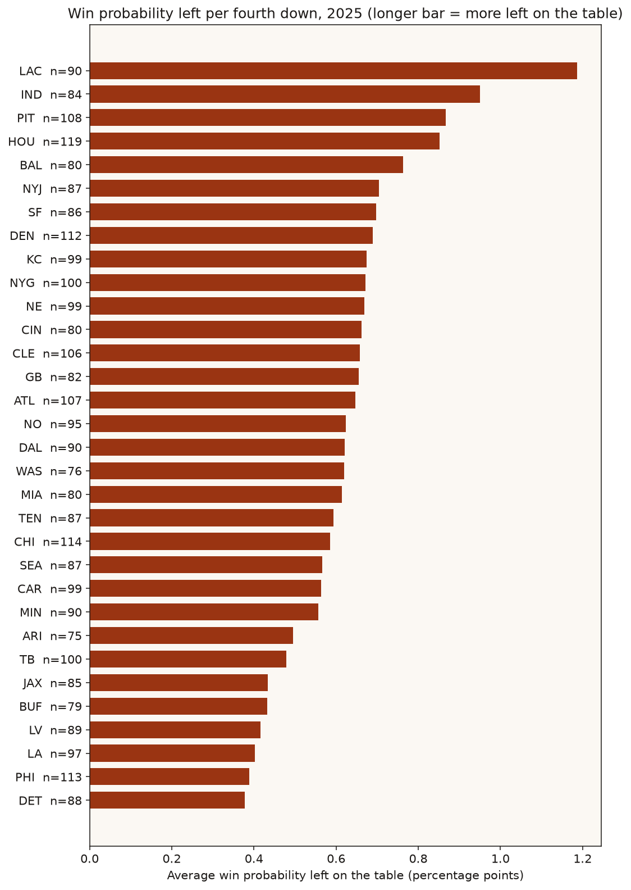

Adding the per-play gaps across 24,749 plays produces a large total. That total is not "wins added." The plays share games, drives, and coaches. The per-play mean, with the standard error next to it, is the claim.

## Five real plays

These are the largest out-of-sample gaps in the graded file, plus one high-leverage call the coach got right. They were not picked because they are famous. The model did not see the result of the play. Spreads and timeouts are from the same row.

**Shane Steichen, Indianapolis at Houston, January 4, 2026 (2025 week 18).** 4th-and-2 from the Houston 4, fourth quarter, 2:42, Indianapolis 27, Houston 29. Houston was favored by 9.5. Steichen kicked a 22-yard field goal, and it was good. The 2025 model, which had not trained on 2025, valued going for it at 36.8%, the kick at 19.6%, and a punt at 8.5%. That is 17.3 percentage points left on the table, the largest clear miss in the file. A field goal that hands a 9.5-point favorite the ball, now down 1, with about two and a half minutes left, is a different state from a field goal in a pick 'em. nflfastR's plain `wp` on the snap was 0.56. `vegas_wp`, which knows the spread, was 0.37, in line with this model's value of going for it.

**Mike Tomlin, Pittsburgh at Baltimore, January 9, 2022 (2021 week 18).** Tied 13–13, 4th-and-1 from the Pittsburgh 44, fourth quarter, 0:44. Pittsburgh had 1 timeout, Baltimore had 2. Baltimore was favored by 3. Tomlin punted 38 yards, fair catch at the Baltimore 18. The model valued going for it at 52.4% and the punt at 35.9%. Left on the table: 16.5 percentage points. With 44 seconds left in a tie, the punt gives Baltimore the ball.

**Kyle Shanahan, San Francisco at the Chargers, September 30, 2018.** 4th-and-1 from the Chargers' 15, fourth quarter, 12:43, San Francisco 24, Chargers 26. The Chargers were favored by 10. San Francisco had 1 timeout. Shanahan kicked a 33-yard field goal, and it was good. Go 28.2%, kick 16.1%, punt 11.0%. Left on the table: 12.1 percentage points. The kick takes a one-point lead and gives the ball back to a double-digit favorite.

**Sean McDermott, Buffalo at Jacksonville, November 7, 2021.** 4th-and-16 from the Jacksonville 48, fourth quarter, 1:11, Buffalo 6, Jacksonville 9. Buffalo was favored by 14.5, with 2 timeouts; Jacksonville had 1. McDermott went for it. Josh Allen's deep ball to Stefon Diggs was incomplete. The model said punt: 55.1% for the punt, 39.7% for going, 25.0% for a field goal that would have been about 65 yards and is treated as unavailable only past 68. Left on the table: 15.4 percentage points. This is the other tail. A 14.5-point favorite, down 3, with two timeouts, can still get the ball back after a punt. A failed 4th-and-16 gives Jacksonville the ball near midfield with the lead.

**Joe Philbin, Green Bay at the Jets, December 23, 2018.** Philbin was the interim head coach. 4th-and-1 from the 1, fourth quarter, 1:16, Green Bay 30, Jets 35. Green Bay was favored by 3 and had no timeouts. He went for it. Aaron Rodgers scored. The model said go, at 46.2%, against a field goal at 15.5% and a punt at 4.2%. The edge was 30.7 percentage points, and the win probability left on the table was zero. A field goal would have made it a two-point game and given the Jets the ball. The touchdown took the lead.

## Limitations

- The opening-kickoff chart has no field-goal region. Early, this model moves a 3-point lead less than `vegas_wp` does. On 1st-and-10 in the first five minutes, 61 plays with the offense up 3 have an average `vegas_wp` of 0.621, against 0.545 when tied (12,851 plays). The app model, at a similar early state (home, own 25, about 58 minutes left), says 0.582 up 3 and 0.514 tied. For the team receiving a kickoff while down 3, in the first few minutes between their 20 and their 35, nflfastR `wp` averages 0.434 and `vegas_wp` 0.455 (94 plays). The app model is about 0.485 for that defense. Three or four points of win probability is enough to erase a field-goal band when going for it only leads by that much. The late-game charts, where a field goal changes the game state, do show the band. I would not tell a coach "never kick on the opening drive" from the green cells alone. I would say the model thinks it is close, and that the early score slope is the soft spot.
- Season-ahead Platt scaling did not reduce held-out log loss (0.450 raw, 0.452 scaled). The calibration plot is still the right picture of whether 70% means 70%.
- The cold coefficient on field goals is positive and statistically detectable, and it is probably selection. It rarely flips a recommendation. Wind, dome, and Denver do not clear a conventional significance bar.
- Conversion and kicking rates are league averages. Team offense, quarterback, and kicker strength are not in those models. The spread carries pregame team strength into win probability only.
- Overtime is excluded. Ties are dropped from win-probability training. After a change of possession the model uses `1 − opponent win probability`, which ignores the small chance of a tie.
- The leaderboard standard error treats plays as independent. They are not. Coaches with a few hundred decisions can still change places.
- The app bundle is fit through 2024 and scaled on 2025. Historical grades use the stricter season holdout. A number in the app and a number in the coach table are not the same fit.
- Kickoff touchbacks are a rule, not a fit: own 20 through 2015, own 25 for 2016–2023, own 30 from 2024 on.

## What is in the repo

```
app/streamlit_app.py          one situation in, three win probabilities out
notebooks/fourth_down_story.ipynb
src/fourth_down/              data, features, models, decision engine, plots, pipeline
sql/                          DuckDB aggregations for teams, coaches, and the trend
scripts/pull_data.py
scripts/run_pipeline.py
tests/                        football rules, metrics, and the decision engine
data/raw/pbp_slim.parquet     created by scripts/pull_data.py
models/current.joblib
results/                      summary.json, decisions.parquet, metric and leaderboard tables
figures/
LEARNING_NOTES.md             the concepts, in plain English, with interview questions
```

`LEARNING_NOTES.md` is the study guide: win probability, expected points versus win probability, the conversion and kicking models, calibration, season holdout, and how a recommendation is built. It includes the questions a hiring manager is likely to ask, and answers that use the numbers above.
